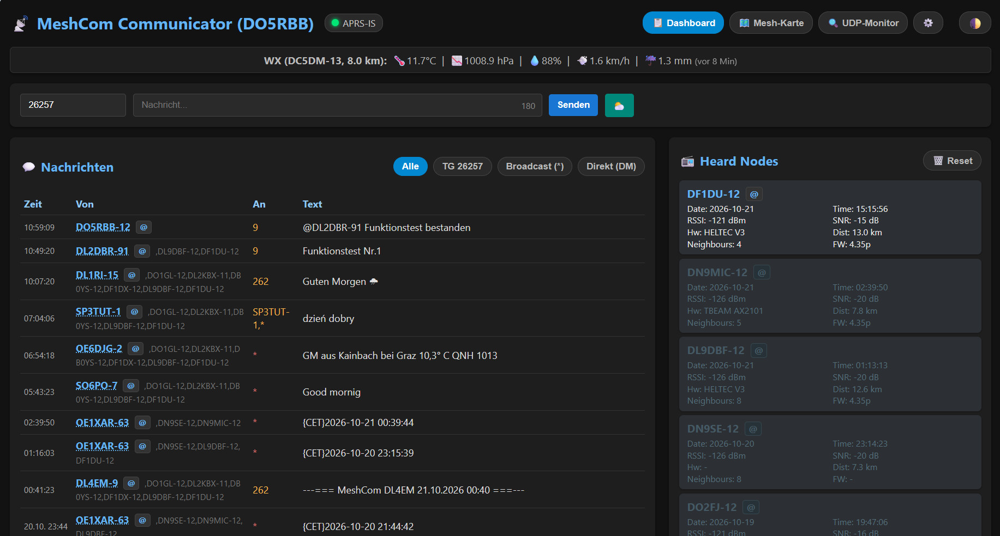
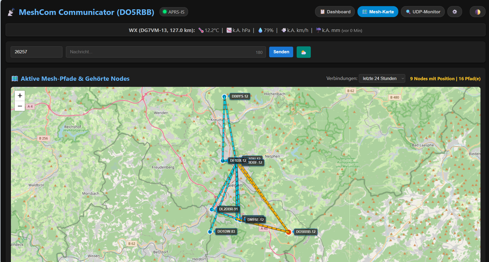
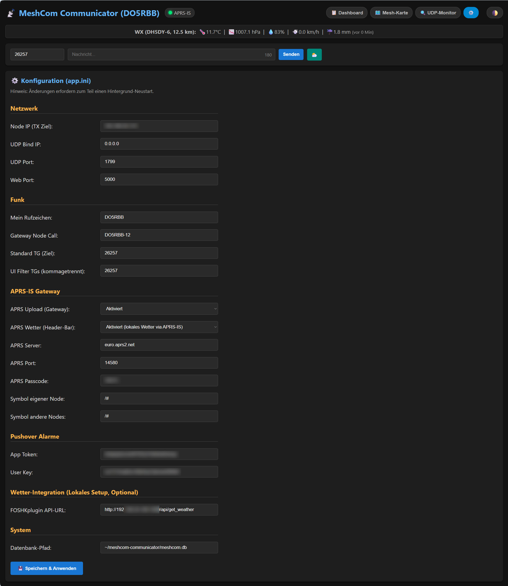

# MeshCom Communicator

Ein interaktives Web-Dashboard und Backend für [MeshCom](https://icssw.org/meshcom/) Nodes. Das Skript lauscht auf den `extUDP`-Port (Standard: 1799) des Nodes, speichert alle Telemetrie- und Chat-Daten in einer lokalen SQLite-Datenbank und stellt sie visuell im Browser dar.

## Features
- **Live-Karte (Leaflet):** Zeichnet eigene Nodes, gehörte Stationen und aktive Mesh-Pfade (Routen) dynamisch auf einer Landkarte ein. Inklusive Entfernungsberechnung und klickbaren Markern.
- **Chat-System:** Senden und Empfangen von Nachrichten an Talkgroups (z. B. 26257), Direct Messages (DM) oder Broadcasts (*).
- **Heard Nodes:** Kompakte Übersicht aller empfangenen Stationen inkl. RSSI, SNR, Distanzberechnung, Hardware und Firmware-Version. Inaktive Nodes (> 3h) werden optisch markiert.
- **APRS-IS Gateway (IGate):** Optional zuschaltbare TCP/IP-Weiterleitung an das weltweite APRS-Netzwerk (z. B. aprs.fi). 
  - *Intelligent:* Pusht nur den eigenen Node und direkt über HF empfangene Stationen (1 Hop), um Endlosschleifen im APRS-Netz zu verhindern. 
  - *Spam-Schutz:* Integrierter 15-Minuten Throttle pro Rufzeichen und Unterdrückung fehlerhafter GPS-Koordinaten.
  - *Anpassbar:* Eigene APRS-Symbole (z. B. `/I` für das Gateway, `/#` für Remote-Nodes) frei wählbar.
- **Wetter-Integration (APRS & Lokal):** 
  - *Dynamische WX-Leiste:* Ermittelt über den APRS-Datenstrom automatisch die nächstgelegene Wetterstation im Umkreis von 25 km und zeigt Temperatur, Luftdruck, Wind und Regen live im Header an.
  - *FOSHKplugin:* Abruf lokaler Wetterdaten der eigenen Heim-Wetterstation per Knopfdruck, um sie als Textnachricht ins Mesh-Netzwerk zu senden.
- **@-Mentions & Quick-DM:** Schnelles Erwähnen und Auswählen von Rufzeichen per Klick direkt aus der Benutzeroberfläche.
- **Pushover-Alarme:** Automatische Push-Benachrichtigungen aufs Smartphone bei eingehenden Direct Messages, Namensnennungen oder Aktivität auf priorisierten Ziel-TGs.
- **Live UDP Monitor:** Zeigt die rohen JSON-Pakete (RX, TX und APRS-Uploads farblich getrennt) zur Fehlerdiagnose in Echtzeit im Browser an.
- **Web-Konfiguration & UI:** Alle Systemparameter (IPs, Ports, Rufzeichen, APRS-Passcode, API-Keys) lassen sich im laufenden Betrieb über das Menü anpassen. Integrierter Dark/Light-Mode.

## Screenshots




## Installation

**1. Repository klonen**
```bash
git clone [https://github.com/rbender23/meshcom-communicator.git](https://github.com/rbender23/meshcom-communicator.git)
cd meshcom-communicator
```

**2. Abhängigkeiten installieren**
Das Skript benötigt das Web-Framework Flask.
```bash
pip3 install -r requirements.txt
```
*(Hinweis für neuere Raspberry Pi OS Versionen: Falls `pip3` einen Fehler bezüglich "externally managed environment" wirft, installiere Flask stattdessen systemweit über die Paketverwaltung mit `sudo apt install python3-flask`).*

**3. Konfiguration anlegen**
Kopiere die Vorlagen-Datei und benenne sie um:
```bash
cp app.ini.example app.ini
```

**4. Anwendung manuell starten (Test)**
```bash
python3 app.py
```
Das Web-Interface ist nun lokal oder im Netzwerk unter `http://<IP-DEINES-PI>:5000` erreichbar. Mit `Strg+C` kannst du das Skript wieder beenden.

---

## Konfiguration & Erste Schritte
Nach dem ersten Start wird die `app.ini` automatisch eingelesen. Die gesamte Konfiguration erfolgt bequem über das Web-Interface (Reiter "⚙️ Einstellungen"):

- **Netzwerk & Funk:** Trage hier die IP deines MeshCom-Nodes sowie deine Rufzeichen (z. B. `DO5RBB` und `DO5RBB-12`) ein.
- **APRS-IS Gateway:** Um als IGate zu fungieren, aktiviere den Upload und trage deinen persönlichen, 5-stelligen **APRS-Passcode** ein.
- **Wetter-Integration:**
  - *APRS Wetter (Header-Bar):* Nach der Aktivierung sucht das System automatisch nach APRS-Wetterstationen im 25km Umkreis. **Voraussetzung:** Dein eigener Node muss mindestens einmal eine gültige GPS-Position gefunkt haben, damit das System den Mittelpunkt kennt.
  - *Lokales Wetter (Button):* Trage die API-URL deines FOSHKplugins ein (z. B. `http://192.168.x.x:1080/api/get_weather`), um deine eigenen Sensordaten abzurufen.

*Hinweis: Nach dem Speichern der Einstellungen im Web-Interface startet sich der interne APRS-Netzwerk-Dienst beim nächsten Programmstart mit den neuen Parametern.*

---

## Autostart (Systemd Service)
Um den Communicator dauerhaft und automatisch im Hintergrund laufen zu lassen, richte am besten einen Systemd-Dienst ein:

1. Erstelle die Service-Datei:
   ```bash
   sudo nano /etc/systemd/system/meshcom-communicator.service
   ```

2. Füge folgenden Inhalt ein *(Pfade ggf. anpassen, falls dein Linux-Benutzer nicht `pi` heißt)*:
   ```ini
   [Unit]
   Description=MeshCom Communicator
   After=network.target

   [Service]
   User=pi
   WorkingDirectory=/home/pi/meshcom-communicator
   ExecStart=/usr/bin/python3 /home/pi/meshcom-communicator/app.py
   Restart=always
   RestartSec=5

   [Install]
   WantedBy=multi-user.target
   ```

3. Speichere die Datei (`Strg+O`, `Enter`, `Strg+X`).

4. Dienst aktivieren und starten:
   ```bash
   sudo systemctl daemon-reload
   sudo systemctl enable meshcom-communicator.service
   sudo systemctl start meshcom-communicator.service
   ```

Du kannst den Status jederzeit mit `sudo systemctl status meshcom-communicator.service` überprüfen.
